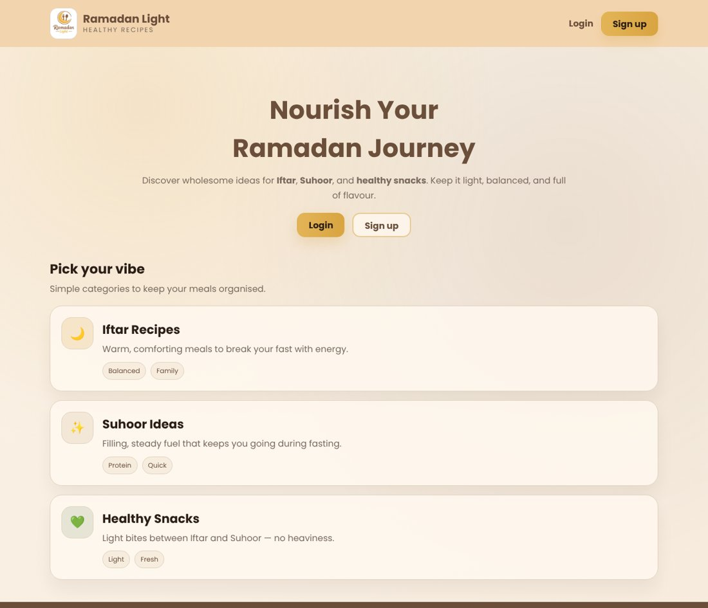
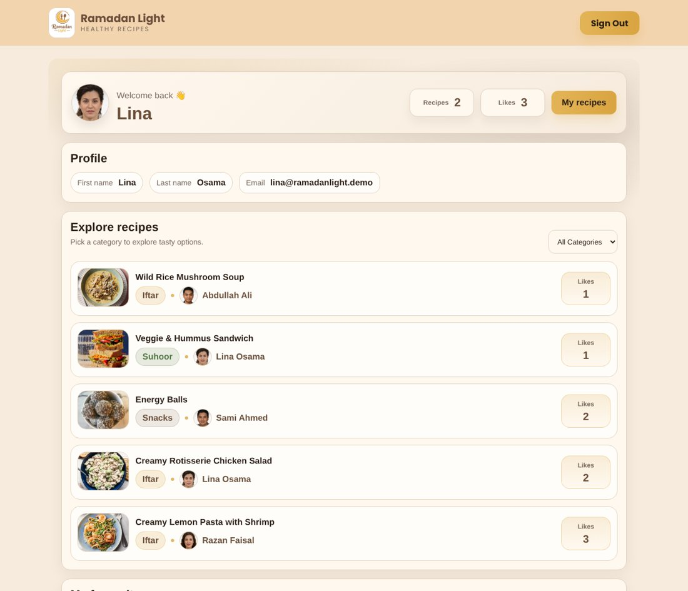
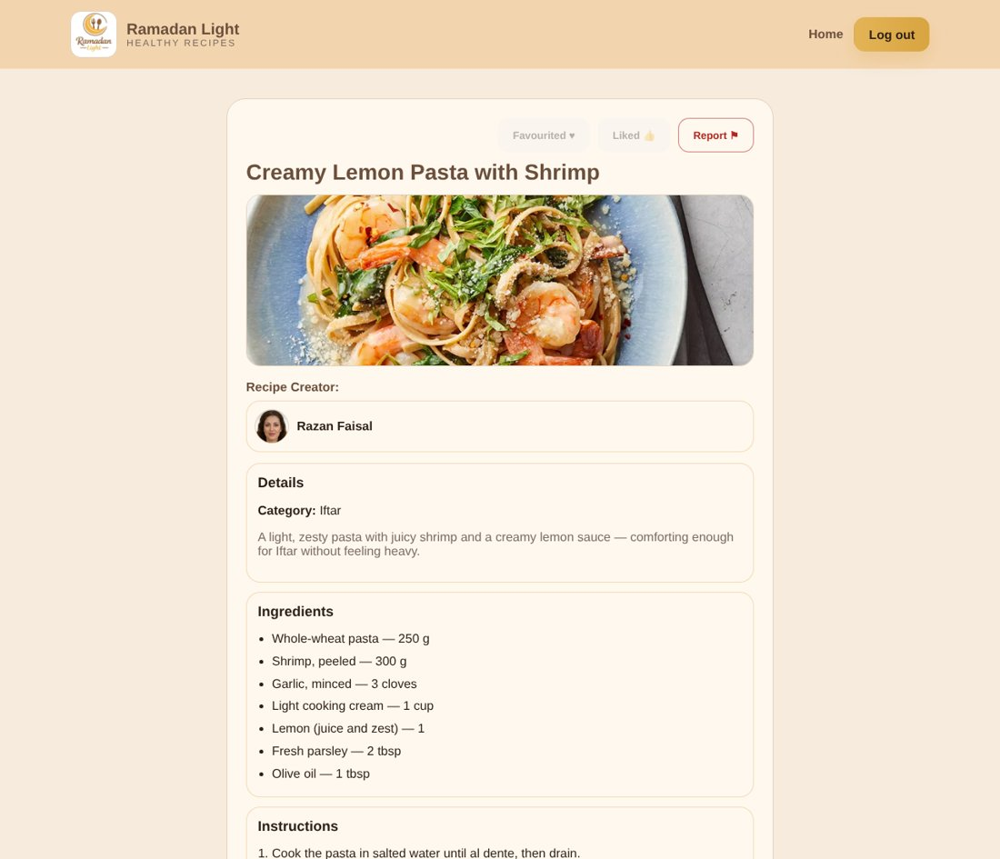

# Ramadan Light — Live Demo

**Try it:** https://leen686.github.io/RamadanLight-Demo/

Ramadan Light is a healthy-recipe sharing web app for Ramadan — Iftar meals, Suhoor ideas and light snacks. Users share recipes, browse by category, like, favourite, comment and report recipes, and an admin moderates reported content.

This repository is an interactive demo of the original university project ([IT329-project](https://github.com/leen686/IT329-project)). It uses the original pages, styles and images, so it looks and works the same, but it runs entirely in the browser so anyone can try it without a server.

## Try it in one click

On the **Login** page, use the "Try the demo" buttons:

| Account | Email | Password |
|---|---|---|
| User | lina@ramadanlight.demo | demo1234 |
| Admin | admin@ramadanlight.demo | demo1234 |

Or create your own account on the **Sign up** page. Everything you do is saved only in your own browser, and **Reset demo data** on the Login page restores the sample recipes.

## Features

**Users**
- Sign up (with optional profile photo) and log in
- Dashboard with profile, recipe and like counts
- Browse all recipes and filter by category (Iftar, Suhoor, Snacks)
- View a recipe: ingredients, steps, video and comments
- Like, favourite, report and comment on other people's recipes
- My Recipes: add, edit and delete your own recipes, with photo and video upload or a video link

**Admin**
- See reported recipes and either dismiss the report or block the recipe's creator
- Blocking removes the user and their recipes and adds them to the blocked list; blocked users can't log in

## How the demo works

| | Original project | This demo |
|---|---|---|
| Pages and design | PHP pages, `css.css`, `css2.css` | Same markup and the same CSS files as static HTML |
| Data | MySQL database | Sample data saved in the browser (`localStorage`) |
| Uploads | Saved on the server | Photos saved in the browser; videos in IndexedDB |
| Login | Server sessions, hashed passwords | Browser-only demo login — not real security |

Code layout: `js/store.js` replaces the PHP/MySQL back end, `js/seed.js` holds the sample data, and each page has a small script that does what its PHP file did. The recipes, users and comments are fictional sample data.

## Run locally

Open `index.html` in a browser, or serve the folder (for example `python3 -m http.server`) and go to `http://localhost:8000`.

## Built with

HTML, CSS and JavaScript. The original project uses PHP, MySQL, HTML, CSS, JavaScript, jQuery and AJAX.

## Team

Ramadan Light was built as a team project for IT329 at King Saud University by:

- Leen Almutairi
- Ranem Ibrahim
- Jana Alshehri
- Jana Aldakheel
- Latifah Alsaif
